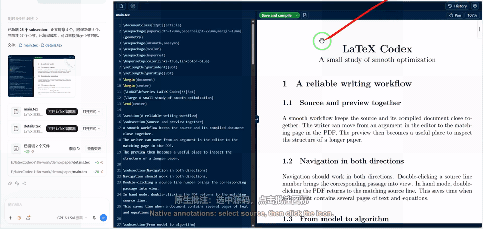
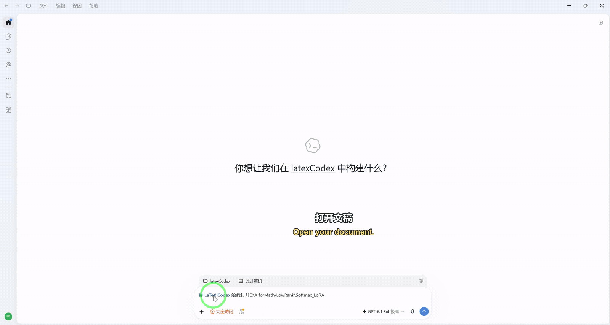
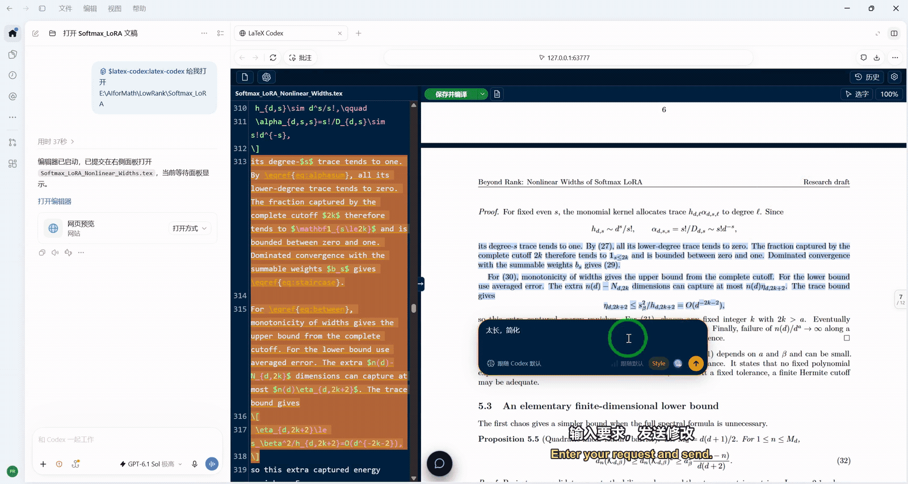
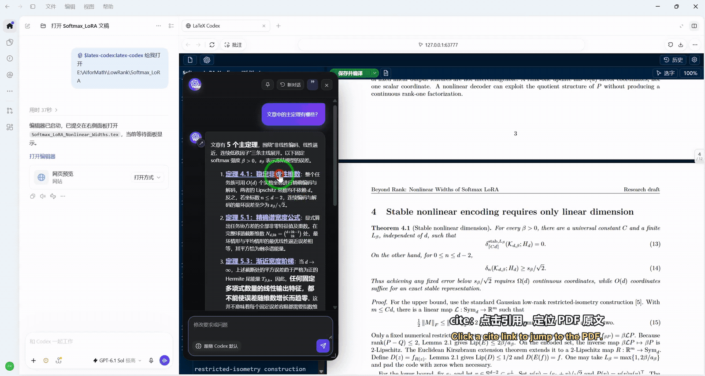
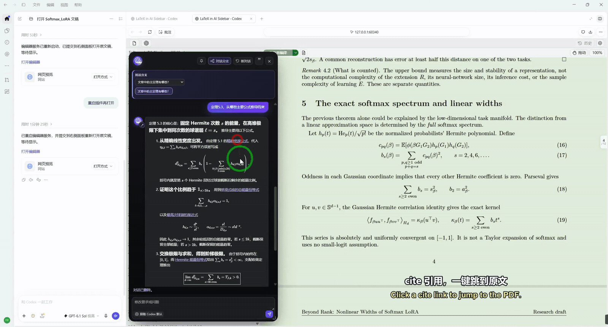
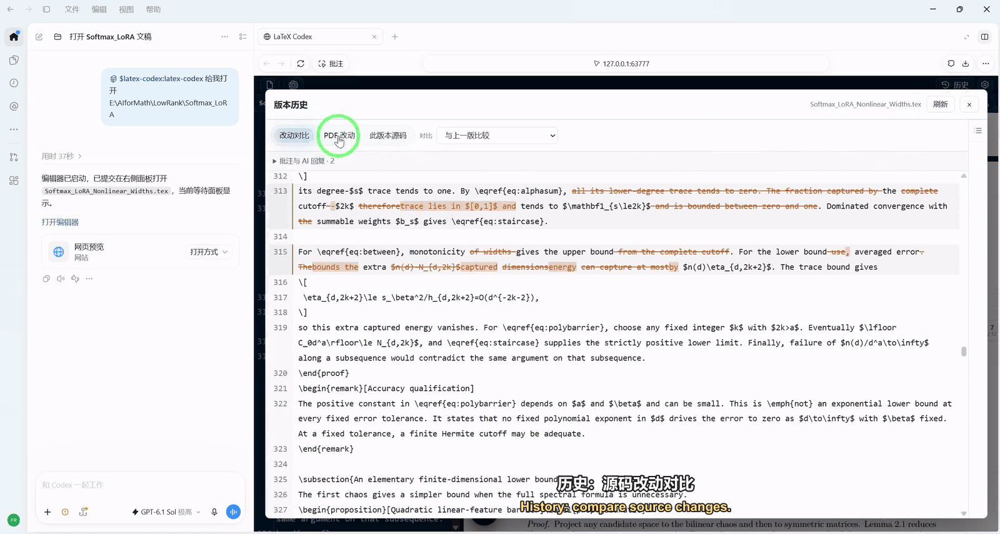
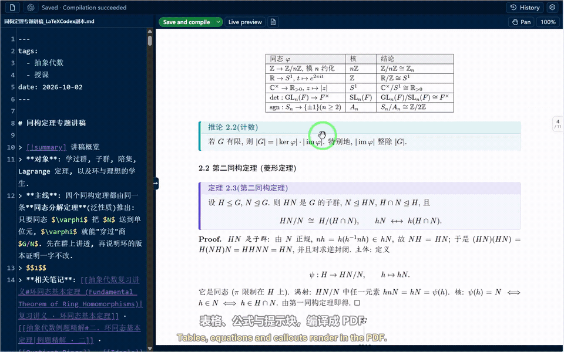

[English](README.md) · [简体中文](README.zh-CN.md)

# LaTeX in AI Sidebar

**Your LaTeX workspace inside your AI app.**

Bring the final step of research into your AI app's sidebar: write LaTeX and Markdown, discuss passages and formulas, and review AI edits alongside a local preview.

Ask Codex: **Use latex-codex to open main.tex**. For DeepSeek Harness, use **latex-deepseek**.

## Demos

All demos include English and Chinese subtitles. Click an image to view the GIF at full size or watch the full video.

### Annotations (main chat)

Select source text, click the annotation icon, and save your requests. Send them together in the main Codex chat.

### Internal annotations (kept out of the main chat)

**Box selection.** Select text or box-select formulas and passages in the PDF to locate their source and add an internal annotation. Right-click to add a comment, or enable automatic comments after box selection in settings.

**AI editing and Proofread.** Enter your request and click **Send**, then review the red/green changes in source and PDF. **Keep** saves each change; **Undo** preserves the original. Toggle source and PDF proofreading separately under **gear**, or enable **Project change review** for edits made by the main chat or external tools.

Choose prompt instructions with **Style** in the annotation toolbar. To mark edits for reviewers, choose **gear → Replacement color**.

### Paper citations and side conversations

Enable **”** in floating project chat to get clickable paper citations. Follow a citation to locate the original passage in source and PDF. Switch between the chat bubble, compact bar and full conversation as you read.

Select chat text to add a quoted annotation or ask in a side conversation. Keep following up in nested branches while the main chat stays visible. Toggle the conversation tree to switch, rename or delete branches with confirmation; drag the divider to resize the two panes.

### Local history

Edits are saved automatically. Compare source changes and the PDF before and after, then restore a previous version.

### Editing and personalization

- **Editor features:** Standard editing by default, with optional Vim and Emacs modes, syntax highlighting, command completion, and inline formula previews.
- **Interface language:** Supports multiple languages and follows your system language, falling back to English. Choose a language manually via **gear → Language**.
- **Themes:** Switch between built-in light and dark themes, or upload or paste a screenshot to generate and save a custom color theme.

### Markdown → PDF

Open `.md` or `.markdown` notes with live preview. Click **PDF preview** to compile tables, equations and TikZ diagrams using your local TeX engine. Markdown also supports source ↔ PDF navigation, AI annotations and history comparisons.

See [Releases](https://github.com/Fr0zenWatter/latex-in-ai-sidebar/releases) for version updates. To subscribe, choose **Watch → Custom → Releases** on GitHub.
