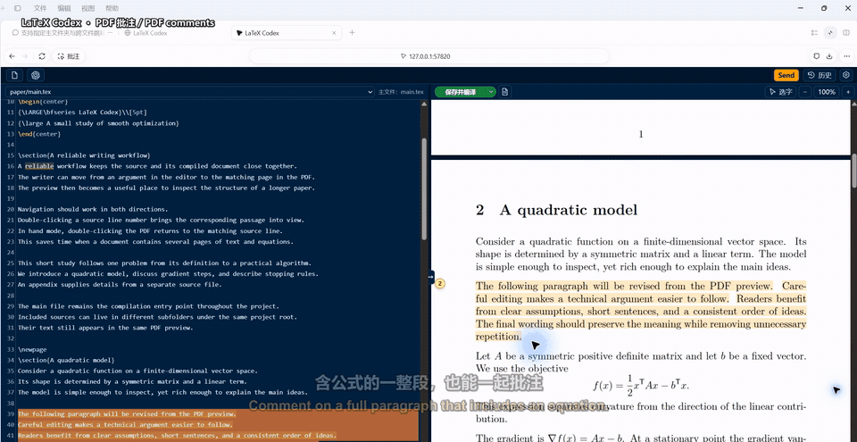
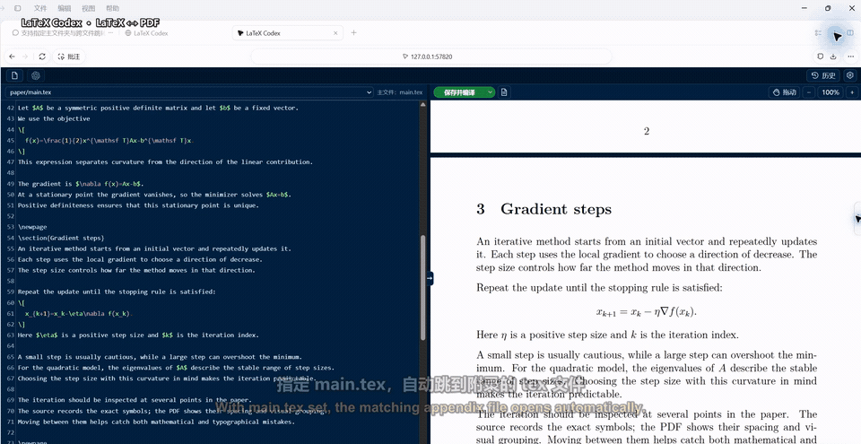
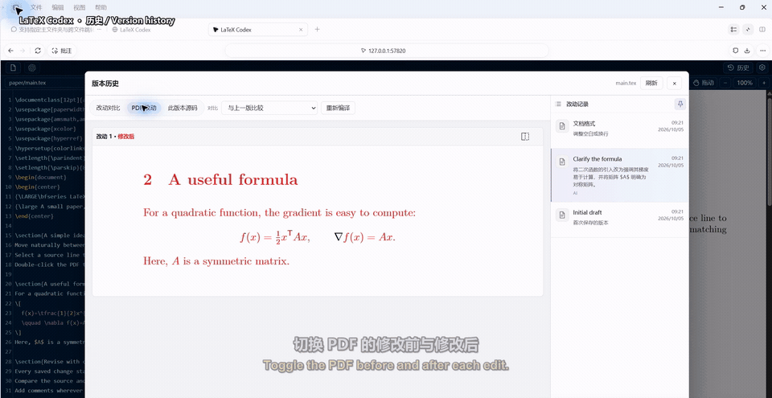

[English](README.md) · [简体中文](README.zh-CN.md)

# LaTeX in AI Sidebar

**Your LaTeX workspace inside your AI app.**

Bring the final step of research into your AI app's sidebar: write LaTeX and Markdown, discuss passages and formulas, and review AI edits alongside a local preview.

Supports **Codex** and **DeepSeek Harness** through separate plugins. Claude integration is planned. Formerly **codex-latex-editor / LaTeX Codex**.

- Select source or PDF text, add comments and click **Send** for AI suggestions. Review each change with **Keep / Undo** in source and PDF, or **Accept all**.
- Discuss your paper in floating project chat, with model and reasoning controls, writing styles and Markdown reply notes. Enable **”** for clickable paper quotations and PDF links.
- Navigate between source and PDF, select text or box-select formulas, and choose a PDF reading background.
- Preview Markdown live, compile PDFs with your existing TeX installation, and revisit autosaved source and PDF history.

Ask Codex: **Use latex-codex to open main.tex**, or launch directly:

```sh
python plugins/latex-codex/scripts/editor.py /path/to/main.tex
```

Open the printed local URL in the side browser. Select source or PDF text, add comments and click **Send**.
Drag one `.tex`, `.md` or `.markdown` file onto the editor or preview to open the original. If the browser hides its path, use **File → Open file**.

Use **latex-codex** for Codex or the independent **latex-deepseek** plugin for DeepSeek Harness. Existing installation commands and local history remain compatible. See [AGENTS.md](AGENTS.md) for installation and maintenance.

## Demos

Click a preview to watch the full demo. All demos include English and Chinese subtitles.

### Annotations (main chat)

Select source text, click the annotation icon, and save your requests. Send them together in the main Codex chat.

[](docs/media/04-native-comments.mp4)

### Temporary annotations (kept out of the main chat)

Switch between **Select text / Pan** above the PDF. In Select text mode, hold **Space** to pan, or **Space + Alt** and drag vertically to zoom. Box-select or drag directly over text, then right-click to add a comment. Settings can open comments automatically after box selection.

Review each suggestion in the source and a temporary red/green PDF preview. **Keep** saves that change; **Undo** preserves the original. Editor and PDF proofreading can be toggled separately under **gear**. Enable **Project change review** to review changes made by the main chat or external tools across project TeX files.

**Style** in the comment toolbar provides prompt instructions for your edits.

Under **gear → Replacement color**, add LaTeX `\color` to edits to show PDF changes to reviewers.

[](docs/media/03-pdf-comments.mp4)

### LaTeX ↔ PDF

In hand mode, double-click the PDF to find its source. Double-click a line number or click the middle **→** to jump back to the PDF. The chapter wheel helps you move through longer documents; setting `main.tex` enables navigation across `\input` / `\include` files.

In **Select text** mode, hold **Space** to pan, or **Alt + Space** and drag to zoom from 30% to 500%.

[](docs/media/01-navigation.mp4)

### Local history

Edits are saved automatically. Compare source changes and the PDF before and after, then restore a previous version.

[](docs/media/02-history.mp4)

### Editing and personalization

- **Editor features:** Standard editing by default, with optional Vim and Emacs modes, syntax highlighting, command completion, and inline formula previews.
- **Interface language:** Supports multiple languages and follows your system language, falling back to English. Choose a language manually via **gear → Language**.
- **Themes:** Switch between built-in light and dark themes, or upload or paste a screenshot to generate and save a custom color theme.

### Markdown → PDF

Open `.md` or `.markdown` notes with live preview. Click **PDF preview** to compile tables, equations and TikZ diagrams using your local TeX engine. Markdown also supports source ↔ PDF navigation, AI annotations and history comparisons.

[](docs/media/05-markdown.mp4)

See [Releases](https://github.com/Fr0zenWatter/latex-in-ai-sidebar/releases) for version updates. To subscribe, choose **Watch → Custom → Releases** on GitHub.
